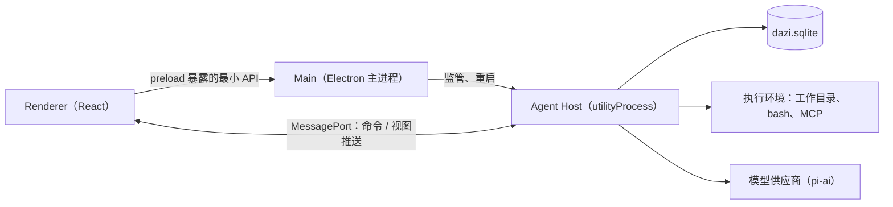
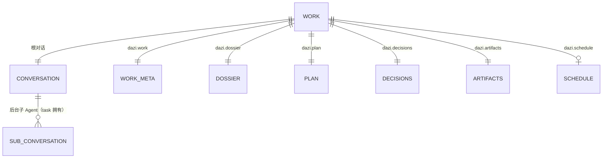
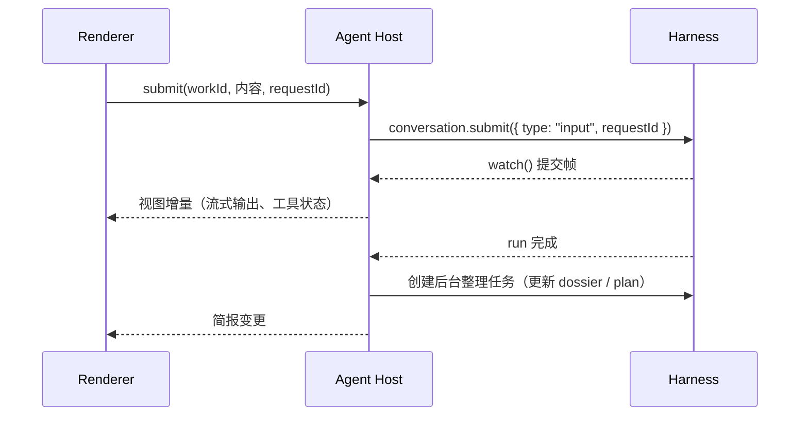

# 技术方案

> 本文描述搭子 v0.1 的目标架构。标注「待 M0 验证」的部分，以技术验证结论为准，验证后更新本文。

## 1. 进程结构



| 进程           | 职责                                                                                                                                    | 不做                                      |
| -------------- | --------------------------------------------------------------------------------------------------------------------------------------- | ----------------------------------------- |
| **Main**       | 窗口、托盘、系统通知、文件夹选择、开机自启、UI 偏好 JSON、建立 Renderer ↔ Host 的 `MessageChannelMain`、监管 Host（崩溃后指数退避重启） | 不打开存储，不跑 Agent，不转发高频流      |
| **Agent Host** | 打开 Harness 与存储、注册 extension、构建执行环境、调度定时推进、生成简报、处理命令                                                     | 不碰 Electron 窗口 API，不持有 UI 状态    |
| **Renderer**   | 全部界面；订阅视图、发送命令                                                                                                            | 不访问文件系统和网络（模型调用都在 Host） |

要点：

- pi-durable 的存储**只允许一个进程打开**，所以只有 Host 打开 `dazi.sqlite`。
- 高频流（模型输出、工具输出）由 Host 经 MessagePort 直接推给 Renderer，不经过主进程，保证主进程始终响应。
- 安全基线：`contextIsolation` 开、`nodeIntegration` 关、`sandbox` 开；preload 只暴露端口握手和少量系统能力。

## 2. 领域模型：「工作」

一项**工作（Work）** = 一个 ownerless 根 Conversation + 一组 Dazi 自定义 Document。



| Document         | 内容                                                                                           | 谁写                              |
| ---------------- | ---------------------------------------------------------------------------------------------- | --------------------------------- |
| `dazi.work`      | 标题、目标、工作目录、状态（进行中 / 暂停 / 完成 / 归档）、创建时间                            | 用户、Host                        |
| `dazi.dossier`   | 工作档案：决策、约定、相关人、踩过的坑、未决问题；每条带来源 entry id；`history: "rewindable"` | 运行后整理任务；用户纠正          |
| `dazi.plan`      | 下一步与待办：条目、状态、来源                                                                 | Agent（可选工具）、运行后整理任务 |
| `dazi.decisions` | 等用户决定的事项：类型（工具审批 / 对外发送 / 方案选择）、内容、状态、结果                     | 审批 extension；用户处理          |
| `dazi.artifacts` | 产物清单：路径、标题、摘要、产生它的 entry                                                     | 产物 extension                    |
| `dazi.schedule`  | 定时推进规则：周期、提示内容、上次触发槽位                                                     | 用户                              |

- 所有 Document 都通过 `HarnessOptions.conversationCreated` 在创建工作时初始化，修改都走 `commit()`，与对话 entry 同一事务。
- 内置 Document（`pi.agent`、`pi.live`、`pi.inbox`、`pi.usage`）照常使用，不重复建模。
- 工作列表：扫描 ownerless 根对话并读取 `dazi.work`。是否改用会话级索引 Document，**待 M0 验证**扫描性能后决定。

## 3. Extension 划分

所有 Agent 能力都以 pi-durable extension 交付，按名字注册，存储里只保存名字。

| Extension        | 内容                                                                                         |
| ---------------- | -------------------------------------------------------------------------------------------- |
| `dazi.base`      | 系统提示主体（产品口吻：先结论后过程）、工作目标 section                                     |
| `dazi.dossier`   | 把工作档案渲染为 system section（有 token 上限；只在档案变化时变化，保持 prompt cache 命中） |
| `dazi.approval`  | 审批策略（见 §5）                                                                            |
| `dazi.artifacts` | `declare_artifact` 等产物工具，**可选使用，不强制**                                          |
| `dazi.subagent`  | 后台子 Agent：参考官方 `23-subagent-background` 模式，由 background anchor task 持有         |
| `dazi.mcp`       | MCP 桥接；工具标记为 `deferred`，配合 `tool-search` 按需加载                                 |
| `CodingTools`    | 官方 read / write / edit / bash                                                              |

**Harness 不得劣化模型**：

- 不强制模型调用某个声明/协议类工具才能「完成」。
- 不用 `onYield` 强行续跑来弥补提示问题。
- 后台整理（档案、计划）由独立的后台任务完成，不往主对话里插提示。
- 任何被证明浪费 token 或扭曲行为的机制直接移除，而不是加固。

## 4. 关键流程

### 4.1 推进一项工作



- 正在运行时再次发送：默认 follow-up；用户明确「改方向」时用 `whenBusy: "steer"`。
- 停止：`conversation.abort()`；后台子 Agent 不受影响，除非用户选择「全部停止」（`abort(context, { background: true })`）。
- 每次提交都带 `requestId`（Renderer 生成 UUID），重试和重启都不会重复提交。

### 4.2 崩溃与重启

1. Host 启动：`Harness.open(openNodeSqliteStorage(path))` → 注册相同的 extension → `harness.resume()`。
2. 未完成的任务从最近检查点续跑；未声明 `replay: "safe"` 的工具调用不会自动重跑，而是保留中断记录，由模型决定下一步。
3. `harness.closed` 以 `failed` 结束（存储错误）时，Host 退出，由 Main 重启。
4. Host 进程意外退出时，Main 指数退避重启并重新握手 MessagePort，Renderer 从当前视图重新订阅（官方语义：迟到或重连的客户端从当前视图开始，不重放历史）。

所有自定义工具必须明确声明 `replay` 策略；有外部副作用的工具需要自己保证幂等。

### 4.3 定时推进

pi-durable 提供持久任务，但不提供定时触发，所以由 Host 内的轻量调度器负责：

- 读取所有工作的 `dazi.schedule`，计算下一个触发槽位。
- 到点后以 `requestId = schedule:<workId>:<槽位>` 提交输入，天然幂等。
- 电脑睡眠或应用未运行期间错过的槽位，只补跑最近一次，不批量补跑。
- 应用驻留托盘；用户可开启开机自启。

### 4.4 简报

简报是 Host 从已提交状态计算出的**投影**，不是另存的数据：

| 区块       | 数据来源                                                                                 |
| ---------- | ---------------------------------------------------------------------------------------- |
| 等你决定   | 各工作 `dazi.decisions` 中 pending 的条目                                                |
| 已经推进   | 自上次查看以来完成的 run、新增产物、失败与中断（`dazi.artifacts`、entry、`taskGraph()`） |
| 建议下一步 | 各工作 `dazi.plan` 中的建议条目，每条可一键开始                                          |

「上次查看」时间存在 UI 偏好里。有待决事项或长任务完成时，Main 发系统通知。

## 5. 审批策略

目标：**只在该打扰时打扰。**

| 类别                                                         | 默认策略                                                             |
| ------------------------------------------------------------ | -------------------------------------------------------------------- |
| 工作目录内的读、写、编辑                                     | 直接执行                                                             |
| 工作目录外的写入                                             | 需要确认                                                             |
| bash                                                         | 直接执行；命中危险模式（删除大范围文件、改系统配置、强推等）需要确认 |
| 对外发送（邮件、提交 PR、推送、调用有外部副作用的 MCP 工具） | 始终需要确认                                                         |

实现方式：`dazi.approval` 包装（`wrapTool`）相关工具；需要确认时向 `dazi.decisions` 写入一条待决事项，等用户处理后继续或返回拒绝结果。包装后的工具声明 `replay: "safe"`，按调用的任务 id 查找已有的待决事项，重启后不会重复询问。

**待 M0 验证**：长时间等待用户的工具调用对 run 和检查点有没有副作用。备选方案是让工具创建一个 child task 并进入 `waiting` 状态。

## 6. Renderer 数据流

- Host 对每个被打开的工作调用 `conversation.watch()`，把每次提交的 Chord 操作通过 MessagePort 推给 Renderer；Renderer 用 `@earendil-works/chord` 应用增量，经 `useSyncExternalStore` 驱动组件。**待 M0 验证** chord 在浏览器环境的可用性；不可用时退回为节流推送完整视图。
- 简报、工作列表是 Host 计算的投影，变更时推送。
- 命令走带类型的 RPC：`createWork`、`submit`、`abort`、`resolveDecision`、`updateDossier`、`setSchedule`、`listWorks`、`getBriefing` 等。命令名、事件名定义为常量，集中在 `src/shared/rpc/`。

## 7. 目录结构（规划）

```text
src/
  main/            Electron 主进程：窗口、托盘、通知、Host 监管
  host/            Agent Host（utilityProcess）
    harness/       Harness 启动、存储、resume、关闭与重启
    extensions/    dazi.* extension
    docs/          Document 定义
    scheduler/     定时推进
    briefing/      简报投影
    rpc/           命令处理
  renderer/        React 界面
    pages/         简报、工作详情、能力、设置
    components/
    theme/         CSS 变量 token（浅色 / 深色）
  shared/
    rpc/           命令、事件类型与常量
    components/    shadcn/ui、ai-elements
docs/
```

## 8. 测试策略

| 层                            | 方法                                                                                        |
| ----------------------------- | ------------------------------------------------------------------------------------------- |
| Extension、Document、简报投影 | Vitest + `MemoryStorage`，伪造模型响应                                                      |
| 崩溃续跑                      | 临时 SQLite 文件：运行中关闭 Harness / 杀进程 → 重开 → 断言续跑结果、无重复提交、无重复审批 |
| 调度                          | 注入时钟，覆盖睡眠补跑、重复触发                                                            |
| 端到端                        | 录制的供应商回放磁带跑完整黄金路径；prompt 有意变更后重录                                   |
| 界面                          | 浅色 / 深色、窄窗口、长文本、键盘焦点的实际渲染检查                                         |

## 9. 里程碑

| 阶段                        | 内容                                            | 验收标准                                                                                                                                                                                                                         |
| --------------------------- | ----------------------------------------------- | -------------------------------------------------------------------------------------------------------------------------------------------------------------------------------------------------------------------------------- |
| **M0 技术验证**（1 周）     | Electron + utilityProcess + pi-durable 最小闭环 | ① Electron 内置 Node 满足 ≥22.19 且 `node:sqlite` 可用；② 创建工作 → 提交 → 运行中杀掉 Host → 重启后续跑完成；③ 结果写入 `dazi.dossier` 并在 Renderer 实时显示；④ 审批等待方案选定；⑤ chord 增量在 Renderer 可用或已选定备选方案 |
| **M1 推进一项工作**（2 周） | 工作创建、对话、工具、审批、产物、工作档案      | 黄金路径前半段可用；崩溃续跑回归测试通过                                                                                                                                                                                         |
| **M2 简报与定时**           | 简报首页、定时推进、系统通知、后台子 Agent      | 「今晚交代，明早看简报、一键批准」完整走通                                                                                                                                                                                       |
| **M3 打磨与发布**           | 文案、空状态、错误恢复、打包、自动更新          | macOS / Windows 安装包；外部用户试用                                                                                                                                                                                             |

## 10. 开放问题

- 跨工作的个人偏好（称呼、写作风格、常用工具）放在哪里：单独的 profile 对话 + Document，还是推迟到 v0.2？
- 模型配置：默认只支持用户自带 API Key，还是同时提供托管服务？
- 子 Agent 的模型与成本上限如何呈现给用户？

## 11. UI-first 切片

当前分支先实现 Renderer 的完整界面与内存演示适配器。`src/renderer/state` 的不可变视图是 UI 验证夹具，刷新即丢弃；不替代上文 Host 的唯一存储。创建工作、消息暂存、决定、档案和定时表单只改变演示投影，不执行工具、定时任务或模型请求。后续接入 Agent 时使用 Host 视图替换这个适配器，并单独完成 M0 安全及崩溃续跑验证。
